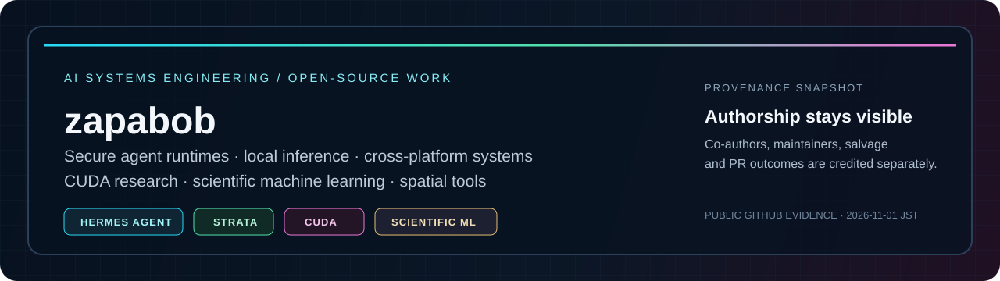
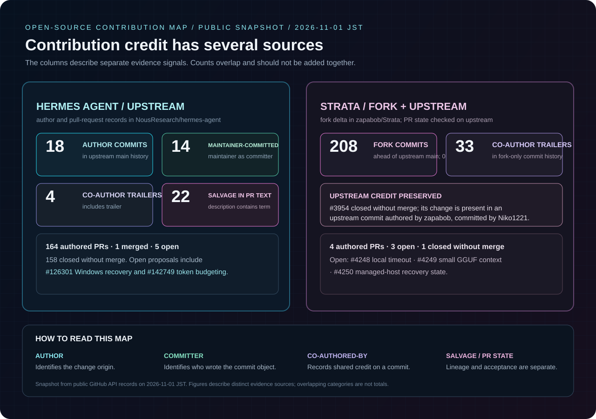
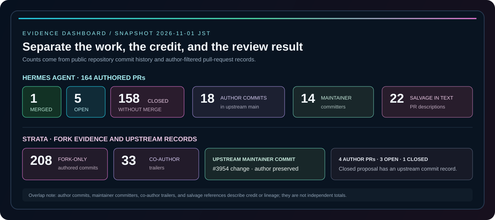

<div align="center">
  
</div>

<h1 align="center">zapabob — AI Systems Engineer</h1>

<p align="center">
  Secure agent systems, local inference, cross-platform engineering, CUDA research, and scientific machine learning.
</p>

<p align="center">
  <a href="https://github.com/NousResearch/hermes-agent/commits/main/?author=zapabob">
    
  </a>
  <a href="https://github.com/zapabob/Strata">
    
  </a>
  <a href="https://github.com/sponsors/zapabob">
    
  </a>
</p>

## Open-source contribution evidence

This snapshot separates code authorship, co-author credit, committers, salvage lineage, and pull-request state. Those signals overlap, so the counts below are not additive. The evidence was checked against the public GitHub repositories on 2026-11-01 JST.

<div align="center">
  
</div>

### Hermes Agent

The public `main` history contains 18 commits with `zapabob` as the GitHub author. Fourteen of those commits name a maintainer as committer, and four contain a `Co-authored-by` trailer. The latter two categories overlap with the author-commit count; they describe credit metadata, not additional commits.

The author-filtered pull-request search returns 164 PRs: 1 merged, 5 open, and 158 closed without merge. Twenty-two PR descriptions explicitly mention salvage. That records the stated lineage or continuation context; it does not mean every patch was accepted upstream.

<div align="center">
  
</div>

| Evidence type | Example | State and attribution |
| --- | --- | --- |
| Merged PR | [#68382 — update protobufjs](https://github.com/NousResearch/hermes-agent/pull/68382) | Merged 2026-07-29 |
| Salvage / continuation | [#114613 — provider fallback policy](https://github.com/NousResearch/hermes-agent/pull/114613) | Closed without merge; body preserves the original implementation and Omar Baradei’s authorship from [open PR #63418](https://github.com/NousResearch/hermes-agent/pull/63418) |
| Salvage of an incomplete fix | [#70343 — GitHub Skills Hub fetches](https://github.com/NousResearch/hermes-agent/pull/70343) | Closed without merge; describes follow-up work on #63920 |
| Open proposal | [#126301 — recover partial Windows pauses](https://github.com/NousResearch/hermes-agent/pull/126301) | Open at the snapshot date |
| Open proposal | [#142749 — share the compression token budget](https://github.com/NousResearch/hermes-agent/pull/142749) | Open at the snapshot date |

Additional source links: [all author-attributed upstream commits](https://github.com/NousResearch/hermes-agent/commits/main/?author=zapabob), [all authored Hermes PRs](https://github.com/NousResearch/hermes-agent/pulls?q=is%3Apr+author%3Azapabob), and [the upstream Hermes Agent repository](https://github.com/NousResearch/hermes-agent).

### Strata

`zapabob/Strata` is a fork of [Niko1221/Strata](https://github.com/Niko1221/Strata). At this snapshot, its `main` has 208 commits ahead of and none behind the upstream `main`; all 208 commits identify `zapabob` as author, and 33 include co-author trailers. These are fork-development figures, separate from upstream acceptance.

One upstream change has maintainer-preserved credit: [PR #3954](https://github.com/Niko1221/Strata/pull/3954) is closed without a merge record, while its change appears in [an upstream commit authored by zapabob and committed by Niko1221](https://github.com/Niko1221/Strata/commit/c7833932a1a3515bb6e4f4c27255f4bb90a53fc4). The fork also has three open proposals: [#4248 — local inference silence timeout](https://github.com/Niko1221/Strata/pull/4248), [#4249 — 1K/2K local GGUF contexts](https://github.com/Niko1221/Strata/pull/4249), and [#4250 — record child absence before publishing host state](https://github.com/Niko1221/Strata/pull/4250).

### Representative engineering areas

| Area | Examples |
| --- | --- |
| Agent security and data boundaries | SSRF redirect checks, credential-path filtering, provider URL validation, archive extraction limits |
| Runtime reliability | Tool-call preservation, provider errors, session state, compression limits and recovery |
| Desktop and cross-platform work | Windows update recovery, model selection, standard-pipe handling, file sync and local-provider behavior |
| Strata inference workflow | Model-setting validation, small-context GGUF loading, host lifecycle and local inference timeout controls |

## Selected projects

| Project | Focus | Why it matters |
| --- | --- | --- |
| [Strata](https://github.com/zapabob/Strata) | Upstream fork development for local inference workflows | A 208-commit fork delta with separate co-author and upstream-PR evidence |
| [hermes-agent](https://github.com/zapabob/hermes-agent) | Agent runtime, plugins, tools, desktop and local AI workflows | Ongoing implementation, salvage and upstream contribution work |
| [Turboquant-CUDA](https://github.com/zapabob/Turboquant-CUDA) | KV-cache quantisation and CUDA measurement | Reproducible LLM systems analysis and model-efficiency experiments |
| [multi-target-pIC50-predictor](https://github.com/zapabob/multi-target-pIC50-predictor) | Transformer-based drug-discovery modelling | Scientific ML with molecular descriptors, receptor targets and Optuna |
| [elastic-looped-transformer](https://github.com/zapabob/elastic-looped-transformer) | Experimental Transformer research | Architecture implementation, self-distillation and GRPO experiments |
| [jaxa-earth-vrchat-terrain](https://github.com/zapabob/jaxa-earth-vrchat-terrain) | Earth-observation to VR pipeline | Data engineering across JAXA inputs, Blender, Unity and VRChat |
| [liltoon-pcss-extension](https://github.com/zapabob/liltoon-pcss-extension) | Unity shader tooling | Production-minded C# and Unity extension development |

## Engineering stack

```text
AI / ML        Python · PyTorch · Transformers · RDKit · Optuna
Agent systems  Hermes Agent · Tool execution · Plugins · MCP · Local-first AI
Frontend       TypeScript · React · Electron · WebUI · TUI
Systems        Rust · CUDA · Docker · Windows · Linux
Spatial        C# · Unity · Blender · VRChat
```

## Contact

- GitHub: [@zapabob](https://github.com/zapabob)
- X: [@zapabob_ouj](https://x.com/zapabob_ouj)
- Sponsorship: [GitHub Sponsors](https://github.com/sponsors/zapabob)
